# Architecture and low-level design

Modules form a DAG. Core is dependency-free; executor composes the algorithm modules; observability and Spring are
outward adapters. Separate example JVMs use a read-only quote contract. No distributed coordination enters the
resilience call path.

## Framework architecture

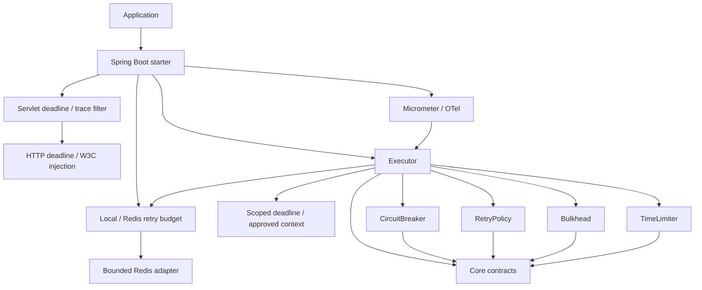

## Call execution

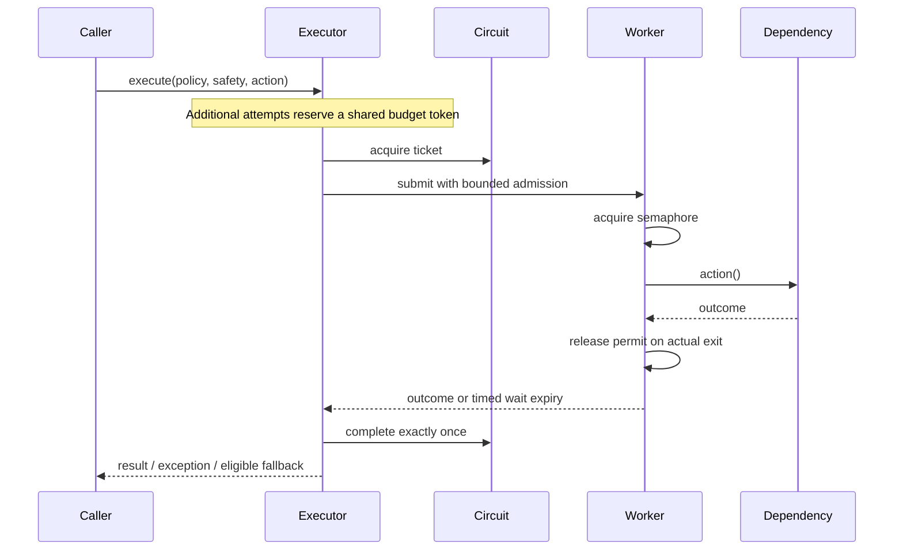

## Circuit states

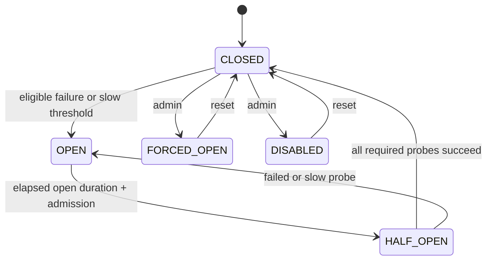

## Retry lifecycle

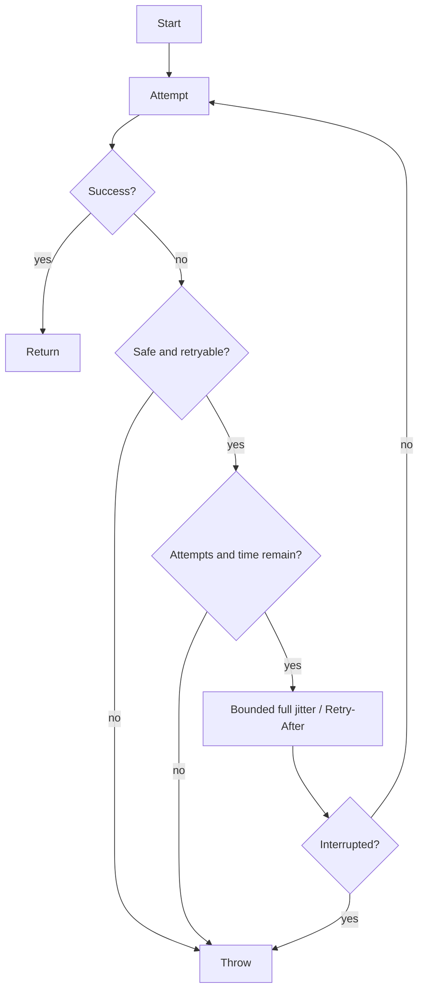

## Bulkhead acquisition

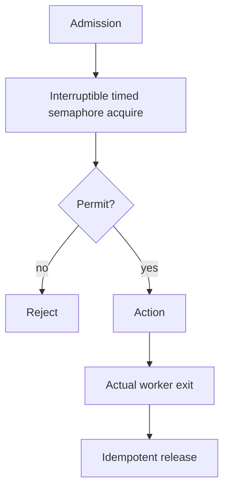

## Timeout and cancellation

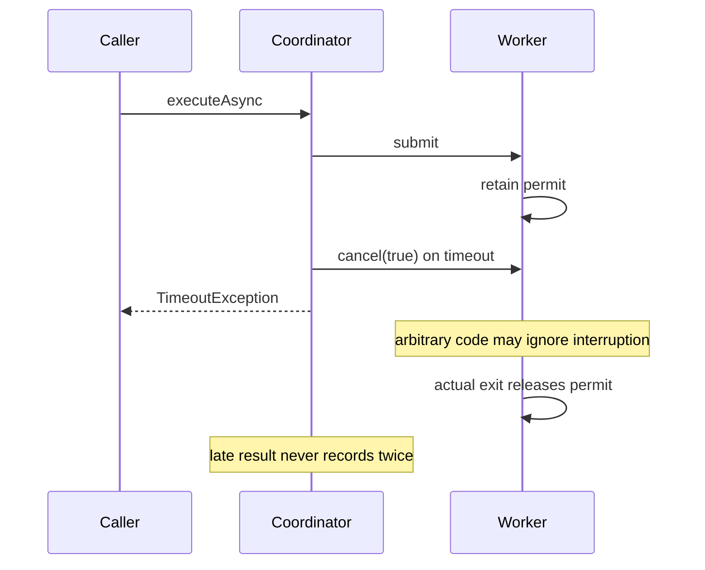

## Fallback evaluation

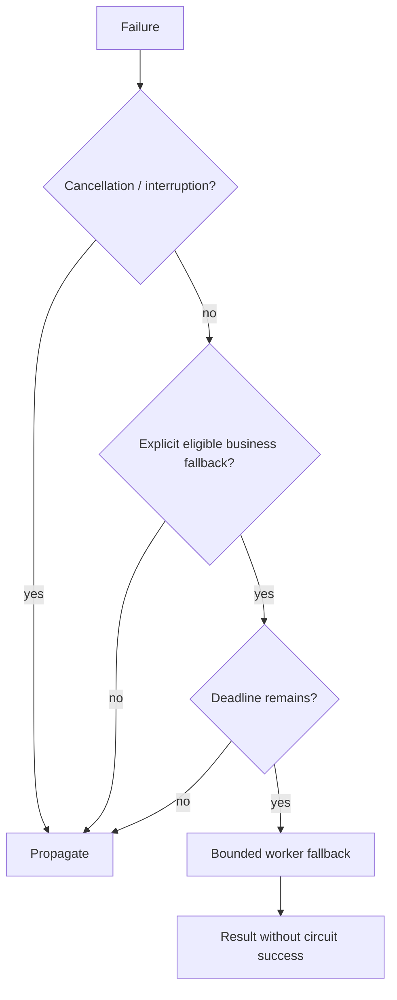

## Composition

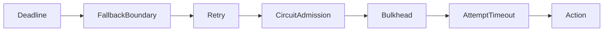

## Spring Boot integration

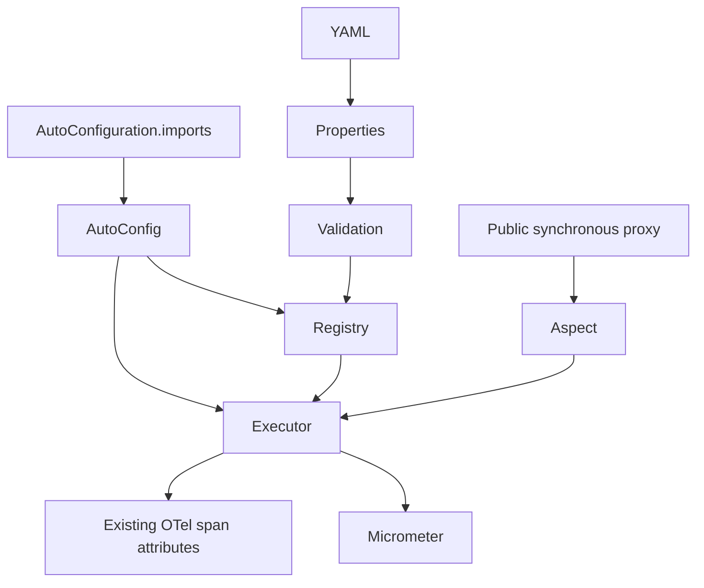

## Recovery

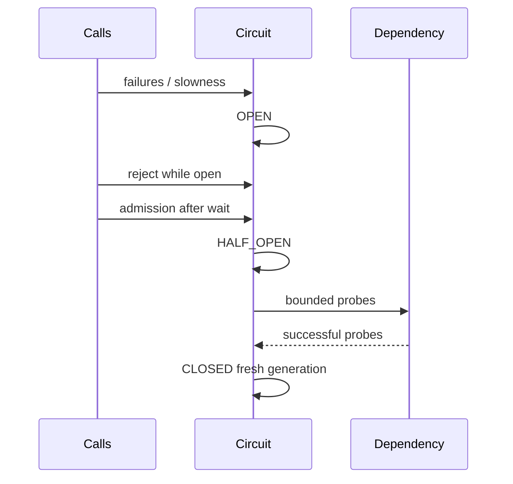

## Class relationships

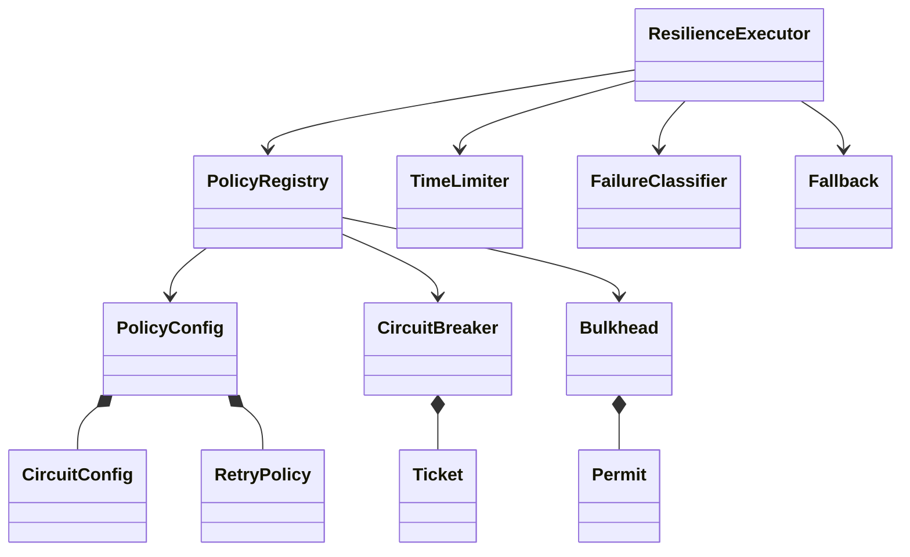

## Deployment

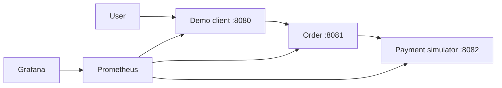
